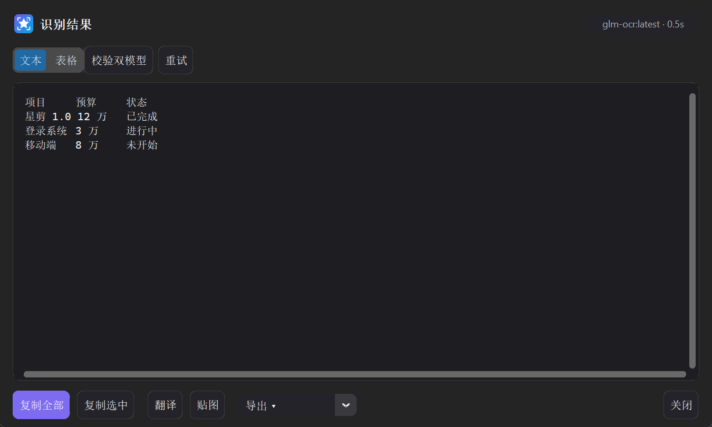
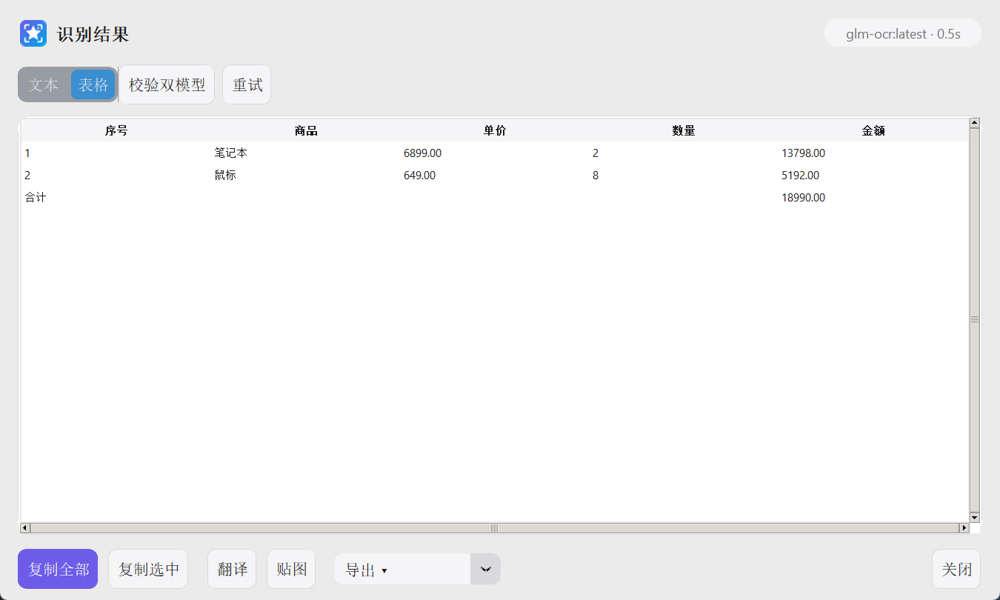
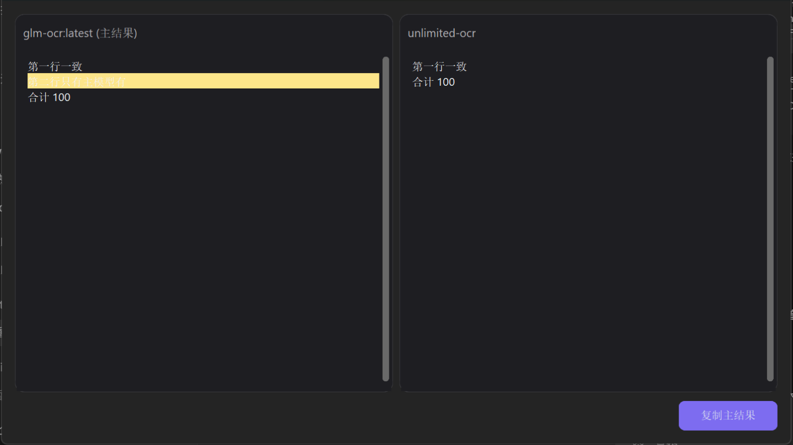
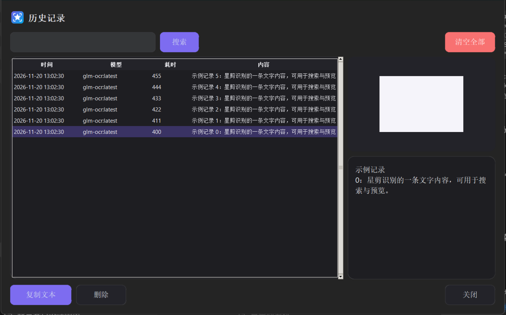
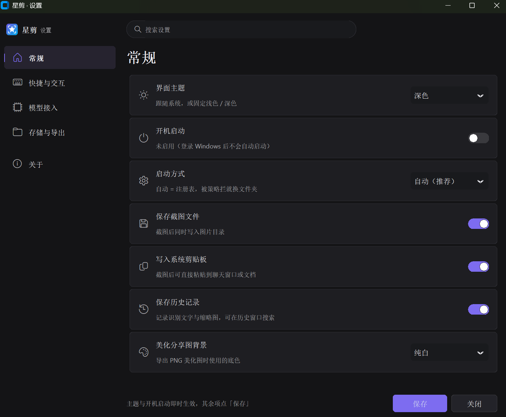

<div align="center">


# 星剪 StarSnip

**截图 → 框选 → OCR 识别 → 编辑 / 翻译 / 贴图 / 美化导出** 的 Windows 桌面小工具

按一下就截图，框一下就有文字

[](https://github.com/NANYAN-01/StarSnip/releases)
[](LICENSE)

现代简约界面（customtkinter）· 本地/内网 Ollama 识别 · 单文件可打包

</div>

---

星剪是一款常驻系统托盘的截图 OCR 工具：按下全局热键框选屏幕区域，自动识别其中的文字，
在浮窗里编辑、复制，一键**翻译**、**贴图钉屏**、生成**美化分享图**，或经 AI 排版导出为
Word / TXT / XLSX / Markdown。

模型接入支持**本地 Ollama 与云端 OpenAI 兼容服务**：OCR、主 LLM（翻译）、排版布局三个角色可以各选各的厂商，互不绑定。

| 厂商 | 预置 BaseURL | 说明 |
|---|---|---|
| Ollama（本地） | `http://127.0.0.1:11434` | 免 Key；OCR 建议 `glm-ocr` |
| DeepSeek | `https://api.deepseek.com` | `deepseek-chat` / `deepseek-reasoner` |
| Kimi（Moonshot） | `https://api.moonshot.cn/v1` | OpenAI 兼容 |
| 阿里云百炼 | `https://dashscope.aliyuncs.com/compatible-mode/v1` | 视觉模型如 `qwen-vl-max` |
| 腾讯 TokenHub | `https://tokenhub.tencentmaas.com/v1` | 模型名按模型广场填 |
| 火山方舟 | `https://ark.cn-beijing.volces.com/api/v3` | 模型名或接入点 `ep-xxx` |
| 自定义 API | 自己填 | BaseURL / 鉴权头 / 模型名全开放 |

选中厂商会自动填 BaseURL（仍可改成其他地域或代理）；API Key 只写在本机 `config.local.json`，不会进仓库。

默认两个热键：**`Ctrl+2` 截图并识别**；**`Ctrl+1` 只截图**（拖完停留，点 ✓ 才保存/进剪贴板，点 ✕ 放弃）。两个热键都能在设置里改。

> 本项目由早期的个人工具 ScreenOCR 全面改版而来：重命名、UI 重写、新增功能、统一设计系统。

## 下载与更新

- 下载：<https://github.com/NANYAN-01/StarSnip/releases> —— 单文件 `StarSnip.exe`，免安装，丢在一个固定目录即可。
- 自动更新：启动后静默检查（24 小时内不重复联网），发现新版本就后台下载并校验 SHA256，**退出时自动替换并重启**；也可以在「设置 → 关于」里手动检查。
- 关掉自动替换：`config.json` 里把 `update_auto` 设为 `false`（只提示，不下载）。
- 自建更新源（内网/OSS 都行）：`config.local.json` 里填 `"update_url": "https://你的地址/version.json"`，清单格式见仓库根的 `version.json`。
- 升级时旧版本会保留成 `StarSnip.exe.old`，启动成功后自动删除。

## 界面预览

| 识别结果（深色） | 表格视图（浅色） |
|---|---|
|  |  |

| 交叉校验 | 历史记录 | 设置中心 |
|---|---|---|
|  |  |  |

## 主要功能

1. **截图识别**：全局热键（默认 `Ctrl+2`）→ 取景框选 → OCR；`Esc` 取消，`Enter` 确认。
2. **结果浮窗**：文本 / 表格双视图；复制全部 / 选中；表格一键复制 TSV / Markdown。
3. **截图副作用**（可配）：自动存 PNG 到 `图片\StarSnip\`，并写入系统剪贴板，右下角轻提示。
4. **一键翻译**：用通用模型对识别结果做中 ↔ 英互译，再点还原原文。
5. **贴图钉屏**：把截图钉在桌面最上层，可拖动、滚轮缩放、右键复制 / 另存 / 关闭。
6. **美化分享图**：给截图加圆角、柔和投影与留白背景，一键导出 PNG 并复制。
7. **AI 排版导出**：默认排版模型把 OCR 文本整理为规范 Markdown，再本地转换为 Word / TXT / XLSX / Markdown（排版失败自动回退原文）。已解析出表格时直接按行列本地生成，不经过模型——数字不会被改写。
8. **表格模式**：解析失败时用表格提示词重新识别一次；模型给 Markdown 管道表或 HTML 表格都能解析（HTML 会转成 Markdown），不会反复重试。
9. **交叉校验**：主模型用当前 OCR 模型，再并排跑一个对照模型，不一致的行高亮。
10. **历史记录**：SQLite + 缩略图，支持搜索 / 预览 / 复制 / 删除 / 清空。
11. **设置中心**：界面主题（跟随系统 / 浅色 / 深色）、快捷键、开机启动、OCR 模型（只列 OCR 专用模型）、目录、截图后处理集中配置；排版/翻译模型固定用默认值，不提供选择。
12. **托盘 + 全局热键**：左键截图，右键菜单含截图 / 仅截图 / 历史 / 设置 / 配置文件 / 日志 / 退出（快捷键在设置里改）。
13. **MCP 服务**：`--mcp` 以 stdio 暴露 `screen_capture_ocr` 给 Agent 调用。
14. **单实例**：重复双击 exe / 再次运行不会起第二个常驻进程；已运行的实例会轻提示「已在运行」，新进程直接退出。
15. **开机启动**：设置里勾选「登录 Windows 后自动启动星剪」即创建 Windows 计划任务（登录时触发），取消勾选会删除；创建/删除需要一次管理员授权（UAC）。

> 设计取舍：只保留一条多模型路径（按需「校验双模型」），不再有「联合识别」开关；
> 截图是否识别由两个热键分工决定，不再有全局 `auto_ocr` 开关——选项越少，行为越可预期。

## 快速开始

需要 **Windows** 与 **Python 3.10+**。界面依赖 `customtkinter`，图像依赖 `Pillow`。

```bat
:: 创建虚拟环境并安装依赖
python -m venv .venv
.venv\Scripts\python -m pip install -r requirements.txt

:: 源码启动（托盘 + 热键常驻，优先使用 .venv）
run.bat

:: 或直接
set PYTHONPATH=src
.venv\Scripts\python -m starsnip
```

常用参数：

```bat
.venv\Scripts\python -m starsnip --check        :: 检查后端并列出模型
.venv\Scripts\python -m starsnip --file a.png   :: 识别一张图片
.venv\Scripts\python -m starsnip --history      :: 打开历史记录
.venv\Scripts\python -m starsnip --diagnose     :: 后端/托盘/热键体检
.venv\Scripts\python -m starsnip --mcp          :: 以 MCP stdio 运行（需 mcp<2）
```

后端：安装并启动 [Ollama](https://ollama.com)，拉取一个视觉模型（如 `glm-ocr`）与一个
通用模型（如 `qwen3.5:4b`），在设置或 `config.json` 中配置 `ollama_url`。

> 后端在内网/远程机器上？把地址写进同目录的 `config.local.json`（该文件已 gitignore，只在
> 本机生效、不会被提交），例如 `{"ollama_url": "http://<你的主机>:11434"}`。它覆盖
> `config.json` 里的同名键；设置窗口保存时也会写这个文件，仓库里的 `config.json` 始终保持默认占位值。

## 打包为单文件 exe

```bat
tools\build_exe.bat        :: 产出 dist\StarSnip.exe，并复制 config.json 与 assets\ 到 exe 同目录
```

> 需要 `pyinstaller`（已在 requirements.txt）。打包会随附 customtkinter 主题资源与品牌图标。

## 配置（`config.json`，位于 exe 同目录或仓库根）

| 字段 | 默认 | 说明 |
|---|---|---|
| `ollama_url` | `http://127.0.0.1:11434` | Ollama 后端地址（真实内网地址建议放 `config.local.json`，避免提交进仓库） |
| `default_model` | `glm-ocr:latest` | OCR 识别模型 |
| `layout_model` | `qwen3.5:4b` | AI 排版 / 翻译用的默认模型（强制 `think:false`；界面不提供选择，改这里即可换模型） |
| `theme` | `system` | 界面主题：`system`/`light`/`dark` |
| `hotkey` | `ctrl+2` | 全局热键：截图并 OCR 识别 |
| `hotkey_capture_only` | `ctrl+1` | 全局热键：仅截图（拖完停留，✓ 保存 / ✕ 放弃） |
| `verify_models` | glm-ocr + unlimited-ocr | 交叉校验的对照模型；主模型始终是当前 OCR 模型，同名项自动跳过 |
| `max_side_px` | `1280` | 送识别长边上限 |
| `timeout_s` / `layout_timeout` | 60 / 120 | 识别 / 排版超时 |
| `keep_alive` | `30m` | Ollama 模型保活 |
| `save_image` / `image_dir` | `true` / `""` | 截图保存与目录（空=`图片\StarSnip`） |
| `clipboard_image` | `true` | 截图写入系统剪贴板 |
| `toast_ms` | `2000` | 轻提示停留毫秒 |
| `export_dir` | `""` | 导出目录（空=`文档\StarSnip`） |
| `pin_alpha` | `1.0` | 贴图默认不透明度 |
| `beautify_bg` / `beautify_pad_ratio` / `beautify_radius_ratio` | `white` / `0.08` / `0.025` | 美化分享图背景、留白比例与圆角比例 |
| `translate_model` | `""`（回退 `layout_model`） | 翻译专用模型（可选，仅配置文件） |
| `history_enabled` / `history_keep` | `true` / `500` | 历史开关与保留条数 |
| `prompt` / `table_prompt` | 见 `ocr_core.py` | OCR / 表格提示词（默认值单源在常量，config 中可覆盖） |

环境变量：`OLLAMA_URL`、`OLLAMA_MODEL`、`STARSNIP_HOME`（兼容旧 `SCREENOCR_HOME`）。

## 项目结构

```
StarSnip/
├─ config.json
├─ run.bat / requirements.txt
├─ starsnip_launcher.py / StarSnip.spec        # PyInstaller 入口与配置
├─ assets/            starsnip.ico/png, logo.png   # 品牌图标（tools/make_icon.py 生成）
├─ tools/             build_exe.bat, make_icon.py
├─ src/starsnip/
│  ├─ __main__.py      # CLI 与 CTk 根窗口
│  ├─ app.py           # 编排：热键/托盘→截图→OCR→翻译/贴图/美化/导出
│  ├─ theme.py         # 设计系统：配色/字体/间距/外观/图标
│  ├─ ui.py            # 结果窗口 / 校验窗口
│  ├─ history_ui.py    # 历史记录窗口
│  ├─ settings_ui.py   # 设置中心
│  ├─ hotkey_ui.py     # 快捷键录入
│  ├─ overlay.py       # 取景遮罩
│  ├─ toast.py         # 圆角轻提示 HUD
│  ├─ pin.py           # 贴图钉屏
│  ├─ beautify.py      # 美化分享图（Pillow）
│  ├─ imgconv.py       # 截图↔Pillow 互转
│  ├─ capture.py / png.py / clipboard_image.py # GDI 截图 / 编码 / 剪贴板
│  ├─ hotkey.py / tray.py / single_instance.py # 全局热键 / 托盘 / 单实例锁
│  ├─ ocr_core.py / ai_writer.py / mdblocks.py # Ollama 调用 / 排版+翻译 / Markdown 解析
│  ├─ tablefmt.py / writers/{docx,xlsx}.py     # 表格 / 零依赖 OOXML 写入
│  ├─ history.py / screenfiles.py / paths.py / logger.py / config.py / autostart.py
│  └─ mcp_server.py
├─ tests/              # 逐项独立脚本（见下）
└─ docs/               # 开发计划 / 工作日志（历史进度）
```

## 测试

每个 `tests/test_*.py` 为独立脚本（无测试框架）：

```bat
:: 离线快速冒烟（不需要后端 / 桌面窗口）
set PYTHONPATH=src && .venv\Scripts\python tests\test_png.py

:: 全量（PowerShell）
Get-ChildItem tests\test_*.py | % { .venv\Scripts\python $_.FullName }
```

- 需要真实桌面会话（会创建窗口/注册热键）：`test_tray` `test_hotkey` `test_overlay` `test_toast` `test_history_ui` `test_e2e`。
- 需要 Ollama：`test_ocr_core` `test_export` `test_e2e`。
- 纯逻辑：`test_png` `test_tablefmt` `test_writers` `test_history` `test_logger`。

## 致谢与设计参考

界面与交互设计参考了开源同类项目的成熟做法：Snipaste、ShareX、Flameshot、
SnapPin、XPin、SnowAir、Imago、macshot、mark-shot、Umi-OCR 等（贴图、取景吸附、
美化导出、主题跟随系统）。星剪在此基础上保持轻量、可换后端、单文件分发。

## 许可

本工具由个人项目 ScreenOCR 改版而来，作者为 NANYAN-01。如需以特定开源协议发布，
可在仓库根添加 `LICENSE` 文件。OCR 数据层中用于兼容的字段键名沿用上游约定。
